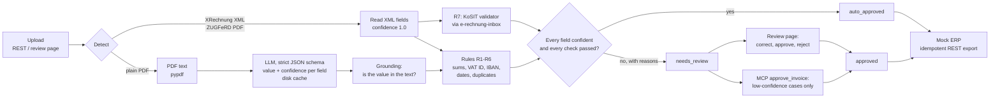

# e-invoice-intake-agent

**[Live demo](https://e-invoice-intake-agent-production.up.railway.app)**: Try it live: 11 sample invoices, cached results, no sign-up, resets hourly.

[](https://github.com/RohithkumarReddipogula/e-invoice-intake-agent/actions/workflows/ci.yml)

**What it does:** reads incoming invoices (XRechnung XML, ZUGFeRD PDF, plain PDF), checks
them, auto-approves only those where every field is confident and every check passes, and
sends everything else to a person with the reason.

**Why now:** since 1 January 2025 every German business must be able to *receive*
e-invoices, and from **1 January 2027** businesses with more than €800,000 turnover in the
previous year must also *send* them in B2B (all businesses from 2028). Inboxes are filling
with XRechnung and ZUGFeRD files, next to the plain PDFs that keep arriving.

**Result on the held-out test split** (75 synthetic invoices, Claude Haiku 5.5 via OpenRouter,
threshold 0.90 fixed on dev): **0 escaped errors, at most 3.9% of invoices (one-sided 95%
bound)**, with 70.7% auto-approved [95% CI 60–81%] and all 19 planted problems held for review.

## Architecture



- **Structured invoices** are read directly from the XML (no LLM) and validated with the
  official KoSIT validator through [e-rechnung-inbox](https://github.com/RohithkumarReddipogula/e-rechnung-inbox),
  installed as a pinned dependency.
- **Plain PDFs** go to an LLM with a Pydantic schema. A field's confidence is the lower of
  the model's own score and *grounding* (the value must appear in the PDF text), because
  self-reported confidence alone is badly calibrated.
- **Every status change** is written to an audit trail (who, when, old and new status, note).
- Details: [SPEC.md](SPEC.md), build log: [PLAN.md](PLAN.md), rollout: [docs/rollout-plan.md](docs/rollout-plan.md).

## Quick start

```bash
git clone https://github.com/RohithkumarReddipogula/e-invoice-intake-agent.git && cd e-invoice-intake-agent
python3 -m venv .venv && .venv/bin/pip install -e ".[dev]"
.venv/bin/python -m intake        # review page on http://127.0.0.1:8000/review
```

Upload with `curl -F "file=@invoice.xml" http://127.0.0.1:8000/invoices`. Optional:

- **KoSIT validation (R7)** needs Docker and the validator image from e-rechnung-inbox
  (`docker build -t erechnung-kosit:1.6.3-2026-08-31 docker/kosit-validator` in that repo).
  Without it, structured invoices go to review with "validation could not run". They are
  never auto-approved unvalidated.
- **ERP export:** `python -m mock_erp` (port 8001). Approved invoices are sent there with an
  `Idempotency-Key`, so retries never create duplicates.
- **LLM for plain PDFs:** copy `.env.example` to `.env` and set `ANTHROPIC_API_KEY` (default
  provider), or `OPENROUTER_API_KEY` with `INTAKE_LLM_PROVIDER=openrouter` and
  `INTAKE_LLM_MODEL=anthropic/claude-haiku-5.5`.
- **Eval without a key or Docker**, from the committed caches:
  `python -m eval.run --split test --provider openrouter --model anthropic/claude-haiku-5.5 --threshold 0.9`

## Demo mode

`INTAKE_DEMO_MODE=1` turns the app into a public demo: visitors pick from 11 sample invoices
of the test split (clean XRechnung, ZUGFeRD and plain PDFs, wrong totals, a bad IBAN, a
duplicate, a low-confidence case, an impossible date) and follow them through review,
approval and the mock ERP.

- **No API key on the server:** the demo refuses to start if one is set. LLM answers and
  KoSIT results come only from the committed caches, the same ones CI uses; a startup
  self-check refuses to start if any sample would miss them.
- **No free text from visitors:** no uploads, the reviewer is "Demo visitor", notes and
  reject reasons are preset options, only amounts and dates can be corrected, and REST
  changes are disabled.
- **Resets every full hour** (invoices, files, ERP), with a banner on every page. Dates are
  checked as of 15 Oct 2026, the eval's reference day, so the samples behave as in the eval.
- Binds to `0.0.0.0:$PORT` in demo mode only; the default stays `127.0.0.1`.

Run it locally in Docker: `docker build -t intake-demo . && docker run --rm -p 8000:8000 intake-demo`.

## Guardrails for production (off by default)

Two settings for real use, both **off by default**. Turn them on in the pilot
([docs/rollout-plan.md](docs/rollout-plan.md)):

| Setting | Effect when on |
|---|---|
| `INTAKE_MAX_AUTO_AMOUNT=10000` | Invoices with a gross total above the limit always go to a person. |
| `INTAKE_REVIEW_NEW_SUPPLIERS=1` | Invoices from a seller without an earlier accepted invoice go to a person, and so do invoices from a known seller with an IBAN never used on its accepted invoices (changed bank details are the classic invoice-fraud pattern). |

A triggered guardrail holds the invoice with the reason. A person can approve it with a
note; MCP's `approve_invoice` refuses it. **The evaluation below was measured with both off**,
and the eval runner keeps them off whatever `.env` says, so the published numbers do not
change when you enable them.

## Evaluation

Synthetic dataset (seed 2026): two splits of 75 invoices each (13 UBL, 12 CII, 15 ZUGFeRD,
35 plain PDFs in three layouts). 25% contain one planted problem (wrong line sum, wrong
gross, bad VAT ID, broken IBAN, impossible date, duplicate) that must never be auto-approved.
Ground truth is what is printed. An **escaped error** is an auto-approved invoice with any
wrong field or a planted problem. Intervals are bootstrap 95% CIs over invoices (10,000
resamples); for a count of 0 the exact one-sided 95% upper bound is given instead.

The dev split was used to compare models and to fix the prompt. The test split was run
once, with model, prompt and threshold fixed beforehand.

| Split · model · prompt | Threshold | Auto-approved | Plain PDFs auto-approved | Wrong values | `line_items` accuracy (PDF) | Escaped errors | LLM cost |
|---|---|---|---|---|---|---|---|
| dev · Haiku 5.5 · v1 | 0.90 | 68.0% [57–79%] | 51.4% [34–69%] | 3 | 91.4% | 0 (≤ 3.9%), but 2 at 0.85 | $0.028 |
| dev · Sonnet 5.5 · v1 | 0.925 | 60.0% [49–71%] | 34.3% [20–51%] | 1 | 97.1% | 0 (≤ 3.9%), but 1 at 0.90 | $0.399 |
| dev · Haiku 5.5 · **v2** | 0.90 | 69.3% [59–80%] | 54.3% [37–71%] | 0 | 100% | 0 (≤ 3.9%) | $0.029 |
| dev · Sonnet 5.5 · **v2** | 0.90 | 73.3% [63–83%] | 62.9% [46–80%] | 0 | 100% | 0 (≤ 3.9%) | $0.406 |
| **test · Haiku 5.5 · v2** | **0.90** | **70.7% [60–81%]** | **68.6% [51–83%]** | **0** | **100%** | **0 (≤ 3.9%)** | $0.029 |

- **v1 → v2:** with v1, every wrong value was a line description that kept the unit code
  ("DAY Consulting day"). Prompt v2 says the description is only the product or service name.
- **Model choice:** after v2 both models were correct on every field, so the 14× cheaper Haiku
  was chosen. The threshold stays at the default 0.90: with zero errors on dev every threshold
  looks safe, and dev alone may raise the threshold but never lower it.
- **Structured invoices** are 100% on every field because they are read from XML. Their real
  test is that KoSIT and the rules caught every planted problem, which they did.
- Total LLM spend for all runs: $0.89 (175 calls), as reported per call by OpenRouter.
  Full reports: [eval/results/](eval/results/), side by side:
  [eval/results/dev-comparison.md](eval/results/dev-comparison.md).
- CI reruns the test eval from the committed caches (no key, no Docker) and fails on any cache
  miss or escaped error.

### Limitations

- **Synthetic and fairly easy data:** every PDF has a clean text layer; real invoices are far
  more varied. 100% here does not mean 100% on real invoices.
- **3 layouts** only.
- **No scans:** PDFs without a text layer are not supported (no OCR); they go to review.
- **Dataset and eval written by the same author** as the pipeline, so they share blind spots.
- **Unit codes named in the prompt:** v2 mentions `C62`, `HUR` and `DAY` as examples. They are
  standard UN/ECE codes, but they also appear in the test data, which flatters the test result
  on line descriptions.

## MCP server

`python -m intake.mcp_server` runs an MCP server over stdio with three tools:

| Tool | What it does |
|---|---|
| `list_invoices` | invoices, newest first, optionally one status (e.g. `needs_review`) |
| `get_invoice` | fields with confidence, checks R1-R7, review reasons, history, ERP state |
| `approve_invoice` | approves an invoice held **only for low confidence** (needs a note); invoices with failed checks are refused and stay for the review page |

Every approval is logged as `mcp:<client name>`. Invoice values are untrusted input, and the
tool descriptions tell the calling model to treat them as data.

Claude Code (from the repository folder):

```bash
claude mcp add invoice-intake -- "$PWD/.venv/bin/python" -m intake.mcp_server
```

Claude Desktop (`claude_desktop_config.json`); use absolute paths, because the working
directory is not the repository:

```json
{
  "mcpServers": {
    "invoice-intake": {
      "command": "/path/to/e-invoice-intake-agent/.venv/bin/python",
      "args": ["-m", "intake.mcp_server"],
      "env": {
        "INTAKE_DATABASE_PATH": "/path/to/e-invoice-intake-agent/data/intake.db",
        "INTAKE_FILES_DIR": "/path/to/e-invoice-intake-agent/data/files"
      }
    }
  }
}
```

## Development

```bash
.venv/bin/ruff check src tests eval && .venv/bin/ruff format --check src tests eval
INTAKE_LLM_OFFLINE=1 .venv/bin/pytest -m "not docker and not live_llm"
```

Tests and CI never call the LLM API (`INTAKE_LLM_OFFLINE=1`: a cache miss is an error and no
client is created). The `docker` tests run the real KoSIT validator; CI runs them in the
`kosit` job.

## License

Apache-2.0. All invoices in this repository are synthetic; companies, people, VAT IDs and
IBANs are invented.
